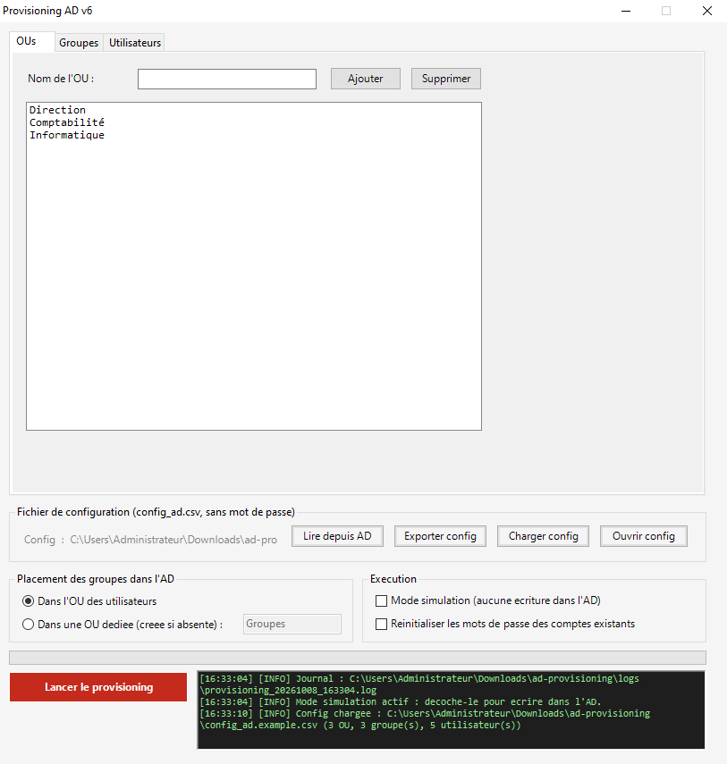
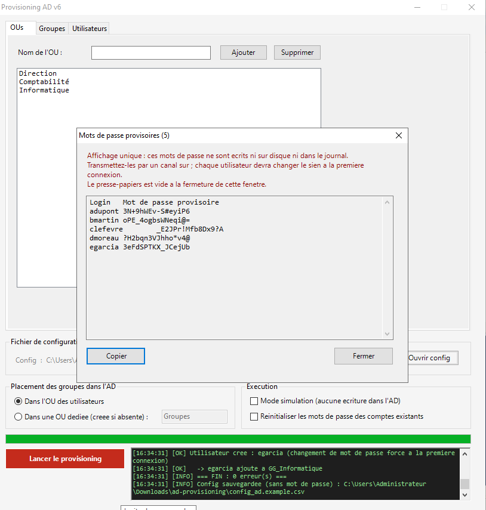

# Provisioning AD

[](https://github.com/anotherj4ck/ad-provisioning/actions/workflows/tests.yml)
[](LICENSE)


Interface graphique PowerShell (Windows Forms) qui crée en masse des **unités d'organisation**,
des **groupes de sécurité** et des **comptes utilisateurs** Active Directory, saisis à la main ou
importés depuis un fichier CSV.

Le projet met l'accent sur la sécurité du provisioning : aucun mot de passe n'est saisi ni stocké.
Chaque compte reçoit un mot de passe provisoire aléatoire, à changer à la première connexion.
Rien n'est écrit dans l'annuaire sans simulation préalable et confirmation explicite.

<!--
## Aperçu

Déposez vos captures dans docs/ puis retirez ce commentaire :




-->

## Fonctionnalités

- Création d'OUs (sous la racine du domaine), de groupes de sécurité globaux et d'utilisateurs,
  depuis l'interface ou depuis un CSV.
- Mise à jour des comptes existants : déplacement vers la bonne OU, prénom, nom, ajout au groupe.
- Placement des groupes dans l'OU de leurs utilisateurs ou dans une OU dédiée.
- Lecture de l'existant depuis l'AD pour repartir de l'état réel de l'annuaire.
- **Mode simulation**, activé par défaut : tout est journalisé, rien n'est écrit.
- **Mots de passe provisoires générés** et affichés une seule fois, avec un bouton Copier.
- Validation de toutes les saisies avant le moindre appel d'écriture à l'AD.
- Journal horodaté de chaque exécution dans `logs\`.

## Prérequis

- Windows, avec Windows PowerShell 5.1 ou PowerShell 7.
- Le module PowerShell **ActiveDirectory** (outils RSAT), dans une console lancée en administrateur :

  ```powershell
  # Windows 10 / 11
  Add-WindowsCapability -Online -Name Rsat.ActiveDirectory.DS-LDS.Tools~~~~0.0.1.0

  # Windows Server
  Install-WindowsFeature RSAT-AD-PowerShell
  ```

  Le script vérifie la présence du module au démarrage et affiche ces commandes s'il manque.
- Un compte autorisé à créer des objets dans les OUs visées. Une délégation de droits sur ces OUs
  suffit, un compte Administrateurs du domaine n'est pas nécessaire.

## Utilisation pas à pas

1. **Récupérer le projet.** S'il a été téléchargé en ZIP, débloquer les fichiers :

   ```powershell
   Get-ChildItem -Recurse | Unblock-File
   ```

2. **Lancer l'interface** depuis le dossier du projet :

   ```powershell
   .\Provisioning_AD.ps1
   ```

3. **Préparer les données** : saisir OUs, groupes et utilisateurs dans les onglets, ou cliquer sur
   *Charger config* et choisir un CSV (par exemple `config_ad.example.csv`).
   Un fichier `config_ad.csv` placé à côté du script est chargé automatiquement au démarrage.

4. **Simuler d'abord.** Laisser *Mode simulation* coché, cliquer sur *Lancer la simulation* et
   lire le journal : chaque ligne `[SIMULATION]` décrit ce qui serait créé, déplacé ou modifié.
   Les erreurs de saisie (login trop long, OU inconnue, doublon…) sont toutes listées et bloquent
   l'exécution.

5. **Écrire dans l'AD.** Décocher *Mode simulation* : le bouton devient rouge (*Lancer le
   provisioning*). Un récapitulatif affiche le domaine cible, le nombre d'OUs, de groupes et
   d'utilisateurs, et l'état de l'option de réinitialisation. Le bouton par défaut est **Non**.

6. **Transmettre les mots de passe provisoires.** En fin d'exécution, une fenêtre les affiche
   une seule fois. Les copier ou les transmettre par un canal sûr, puis fermer : ils sont oubliés
   et le presse-papiers est vidé.

7. **Consulter le journal** : `logs\provisioning_AAAAMMJJ_HHMMSS.log`, à côté du script.

## Format du CSV

Séparateur `;`, encodage UTF-8. Une ligne par objet, la colonne `Type` indique lequel.

| Colonne  | `OU`         | `GROUPE`                 | `USER`                    |
|----------|--------------|--------------------------|---------------------------|
| `Type`   | `OU`         | `GROUPE`                 | `USER`                    |
| `Nom`    | nom de l'OU  | nom du groupe            | *(vide)*                  |
| `OU`     | *(vide)*     | OU du groupe             | OU de l'utilisateur       |
| `Login`  | *(vide)*     | *(vide)*                 | sAMAccountName            |
| `Prenom` | *(vide)*     | *(vide)*                 | prénom                    |
| `Nom2`   | *(vide)*     | *(vide)*                 | nom de famille            |
| `Groupe` | *(vide)*     | *(vide)*                 | groupe (facultatif)       |

Extrait de [`config_ad.example.csv`](config_ad.example.csv) (entreprise et personnes fictives) :

```csv
Type;Nom;OU;Login;Prenom;Nom2;Groupe
OU;Comptabilité;;;;;
GROUPE;GG_Comptabilite;Comptabilité;;;;
USER;;Comptabilité;clefevre;Chloé;Lefèvre;GG_Comptabilite
```

Règles appliquées avant toute écriture :

- **Login** : 20 caractères maximum, sans `" / \ [ ] : ; | = , + * ? < >`, unique.
- **Noms d'OU et de groupes** : 64 caractères maximum, sans `, = + < > # ; \ "` (caractères
  spéciaux d'un Distinguished Name) ni `/ [ ] : | * ?` (interdits dans un sAMAccountName).
- Toute OU ou tout groupe référencé doit figurer dans la configuration.
- L'UPN est construit ainsi : `login@domaine` (ex. `clefevre@contoso.local`).

L'export écrit de l'UTF-8 avec BOM, pour qu'Excel affiche correctement les accents. À la lecture,
un fichier enregistré par Excel en ANSI (*CSV séparateur point-virgule*) est aussi accepté.
**Il n'existe pas de colonne mot de passe.**

## Choix de sécurité

### Aucun mot de passe saisi ni stocké

*Avant* : les mots de passe étaient saisis dans la grille et sauvegardés en clair dans le CSV de
configuration. Un fichier partagé, sauvegardé ou publié par erreur exposait tous les mots de
passe initiaux.
*Maintenant* : il n'y a plus de champ ni de colonne mot de passe. L'export écrit une liste
fermée de colonnes : même un objet qui porterait un mot de passe ne peut pas le faire fuiter
(c'est vérifié par un test).

### Mots de passe provisoires générés par `RandomNumberGenerator`

`Get-Random` s'appuie sur `System.Random`, un générateur non cryptographique. Sa sortie est
prévisible pour qui connaît ou devine la graine. Le script utilise
`System.Security.Cryptography.RandomNumberGenerator`, disponible en PowerShell 5.1 comme en 7 :

- 16 caractères, dont au moins une majuscule, une minuscule, un chiffre et un caractère spécial.
  La complexité AD en exige trois catégories sur quatre, les quatre sont garanties.
- Positions mélangées (Fisher-Yates), pour que les caractères imposés ne soient pas toujours au
  début.
- Tirage sans biais : un simple `octet % n` favoriserait certains caractères, les octets
  au-delà du plus grand multiple de `n` sont donc rejetés.
- Ni `0 O 1 l I`, ni guillemets, espaces, `;` ou `\` : le mot de passe se recopie et se dicte
  sans erreur.

Avec un alphabet de 67 caractères, l'entropie est d'environ 95 bits.

### Changement obligatoire à la première connexion

Les comptes sont créés avec `-ChangePasswordAtLogon $true`. L'administrateur ne connaît que le
mot de passe provisoire, jamais le mot de passe définitif : seul l'utilisateur peut agir sous son
identité.

### Affichage unique, jamais sur disque ni dans le journal

Les mots de passe provisoires n'existent qu'en mémoire. Ils s'affichent une seule fois, dans une
fenêtre dédiée, avec :

- un bouton **Copier** qui marque le contenu pour l'exclure de l'historique (Win+V) et du
  presse-papiers cloud (formats `ExcludeClipboardContentFromMonitorProcessing` et
  `CanIncludeInClipboardHistory`, documentés par Microsoft) ;
- une confirmation avant fermeture, car ils ne pourront plus être réaffichés ;
- le vidage du presse-papiers à la fermeture s'il les contient encore.

Chaque mot de passe est ajouté à la liste dès que le compte est créé. Si l'exécution
s'interrompt, ceux des comptes déjà créés restent donc affichables.

### Pas de réinitialisation silencieuse

L'ancienne version réinitialisait le mot de passe d'un compte existant dès que la colonne était
remplie. Désormais, le mot de passe d'un compte existant n'est jamais modifié, sauf si la case
**Réinitialiser les mots de passe des comptes existants** est cochée (elle est décochée par
défaut). Un mot de passe réinitialisé est lui aussi provisoire, avec changement forcé.

### Anciens CSV avec colonne `MotDePasse`

La colonne est détectée puis ignorée : elle n'est jamais lue dans les objets chargés. Un
avertissement dans le journal invite à ré-exporter la configuration pour réécrire le fichier sans
les mots de passe en clair.

### Simulation par défaut, récapitulatif et confirmation

Le mode simulation est coché au démarrage : un clic distrait ne peut pas modifier l'annuaire.
En simulation, le script ne fait que des lectures (l'objet existe-t-il déjà ?) et journalise ce
qu'il ferait. Les cmdlets AD proposent `-WhatIf`, mais leur sortie part dans la console et non
dans le journal.

Avant une écriture réelle, un récapitulatif montre le **domaine cible** et les volumes. La
confirmation est réglée sur **Non** par défaut.

### Validation des saisies

- Les noms d'OU sont insérés dans des Distinguished Names (`OU=<nom>,DC=…`). Une virgule ou un
  `=` changerait l'emplacement visé : ces caractères sont refusés.
- Les noms de groupes servent aussi de sAMAccountName : la règle la plus stricte s'applique.
- Les valeurs insérées dans les filtres LDAP de recherche sont échappées (RFC 4515), pour qu'une
  parenthèse dans un nom ne modifie pas le filtre.
- Toutes les erreurs sont listées avant la moindre écriture : l'annuaire n'est jamais laissé à
  moitié provisionné à cause d'une ligne invalide.
- Une cellule vide n'efface pas un attribut déjà renseigné dans l'AD.

### Journal horodaté

Chaque exécution produit un fichier dans `logs\`, à côté du script. Il contient le domaine,
l'opérateur, le récapitulatif et le résultat de chaque action, mais jamais un mot de passe.
`logs\` est exclu du dépôt.

### Dépôt public

Le `.gitignore` exclut tous les CSV sauf l'exemple fictif, ainsi que les journaux : une vraie
liste d'utilisateurs ne peut pas être publiée par un simple `git add .`.

### Analyse statique

PSScriptAnalyzer passe sans aucune alerte. La règle
`PSAvoidUsingConvertToSecureStringWithPlainText` est désactivée **uniquement** sur la fonction
`Invoke-Provisioning`, avec une justification dans le code : le mot de passe y est généré en
mémoire, jamais lu depuis un fichier ou une saisie. Ailleurs, la règle reste active.

## Architecture

```text
ad-provisioning/
├── Provisioning_AD.ps1             Interface Windows Forms et écriture dans l'AD
├── src/
│   └── ProvisioningCore.ps1        Validation, mots de passe, lecture/écriture CSV
├── tests/
│   └── ProvisioningCore.Tests.ps1  Tests Pester 5
├── config_ad.example.csv           Configuration d'exemple (fictive)
├── docs/                           Captures d'écran
└── .github/workflows/tests.yml     CI : PSScriptAnalyzer + Pester
```

- `src\ProvisioningCore.ps1` ne dépend **ni de l'AD ni de l'interface**. Il peut donc être testé
  partout, y compris sur les machines de CI qui n'ont pas de domaine. Le script principal le
  charge par dot-sourcing.
- `Provisioning_AD.ps1` contient l'interface et `Invoke-Provisioning`, seule fonction qui écrit
  dans l'AD. Elle ne touche pas aux contrôles de l'interface : elle reçoit les données en
  paramètres et signale sa progression par un scriptblock.
- Les fichiers `.ps1` sont en ASCII. Windows PowerShell 5.1 lit un script sans BOM selon la page
  de codes ANSI, ce qui corromprait les caractères accentués. L'interface est donc sans accents.

## Tests

```powershell
# Une seule fois (Windows PowerShell embarque Pester 3.4, d'où -SkipPublisherCheck)
Install-Module Pester -MinimumVersion 5.5.0 -MaximumVersion 5.99.99 -Scope CurrentUser -Force -SkipPublisherCheck
Install-Module PSScriptAnalyzer -Scope CurrentUser -Force

# Tests unitaires
Invoke-Pester -Path .\tests -Output Detailed

# Analyse statique (aucune alerte attendue)
Invoke-ScriptAnalyzer -Path . -Recurse
```

Les tests couvrent :

- le générateur : longueur, complexité, absence de caractères ambigus, unicité ;
- la validation des logins, des noms d'OU et de groupes, et de la configuration complète ;
- l'échappement LDAP ;
- le CSV : aucune colonne mot de passe, aller-retour avec accents, fichiers ANSI, détection
  de l'ancienne colonne `MotDePasse` ;
- la validité de l'exemple et la syntaxe du script principal.

La CI GitHub Actions les exécute à chaque push et pull request, sous Windows PowerShell 5.1 **et**
PowerShell 7. Les écritures dans l'AD ne peuvent pas être testées en CI, faute de domaine : elles
se valident en simulation, puis sur un domaine de test.

## Limites connues

- **Presse-papiers** : l'exclusion de l'historique Windows (Win+V) et du cloud repose sur des
  formats que Windows respecte, mais qu'un gestionnaire de presse-papiers tiers peut ignorer.
  Tant qu'ils sont dans le presse-papiers, les mots de passe sont lisibles par tout programme de
  la session. En cas de doute, vider l'historique (Win+V, puis *Effacer tout*) ou transmettre les
  mots de passe sans les copier.
- **Mémoire** : les chaînes .NET ne peuvent pas être effacées de force. Les mots de passe restent
  en mémoire jusqu'au passage du ramasse-miettes : fermer PowerShell après usage.
- **Pas de retour arrière** : une erreur en cours d'exécution laisse en place les objets déjà
  créés (tout est journalisé). Une nouvelle exécution est sans danger, car les objets existants
  sont détectés.
- **Périmètre** : OUs de premier niveau sous la racine du domaine uniquement, groupes de sécurité
  globaux uniquement, un seul groupe par utilisateur dans l'interface.
- **Plusieurs contrôleurs de domaine** : les cmdlets peuvent interroger des DC différents. Sur un
  grand domaine, l'ajout à un groupe tout juste créé peut échouer le temps de la réplication ;
  il suffit de relancer.
- **Stratégie de mots de passe** : si le domaine exige plus de 16 caractères, ou si le mot de passe
  contient par hasard le prénom ou le nom (cas rare), la création est refusée et journalisée.
- **Windows uniquement**, à cause de Windows Forms.

## Licence

[MIT](LICENSE) © 2026 anotherj4ck
